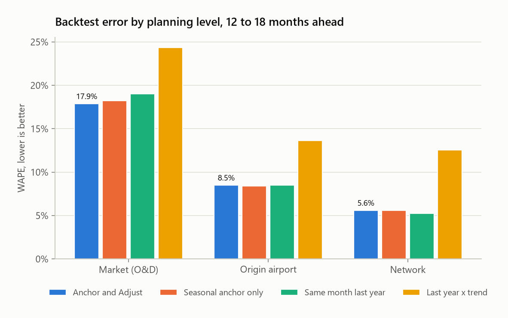
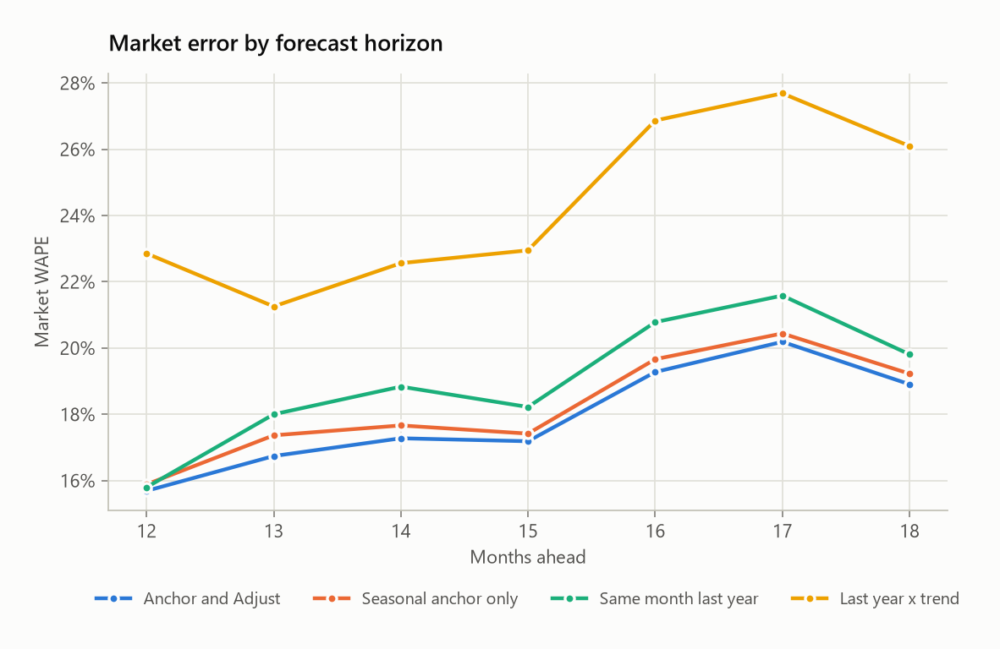
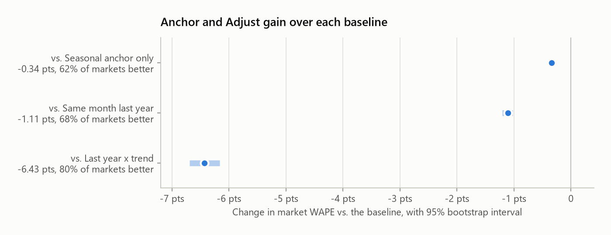
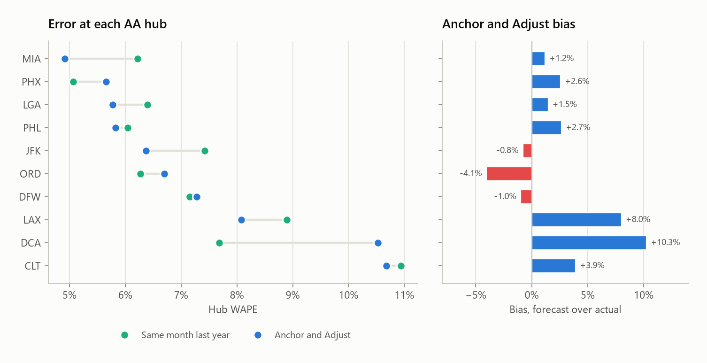
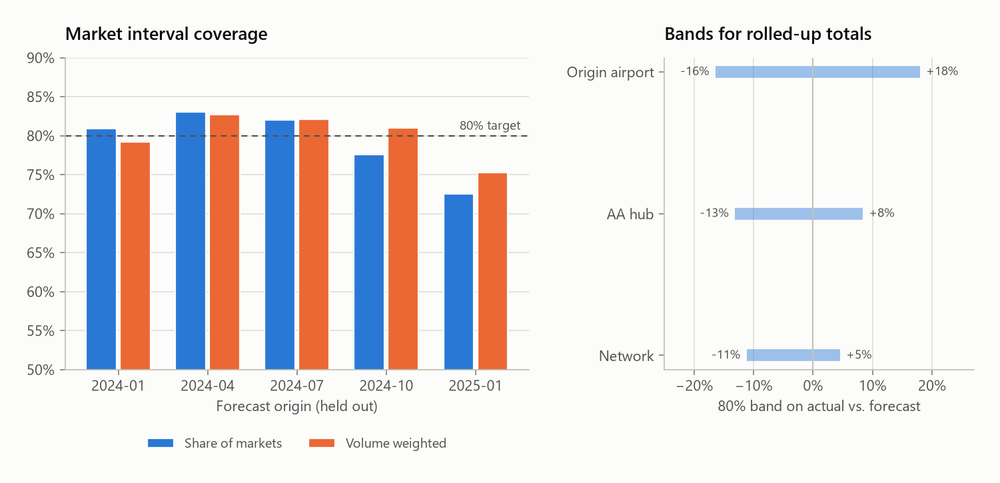
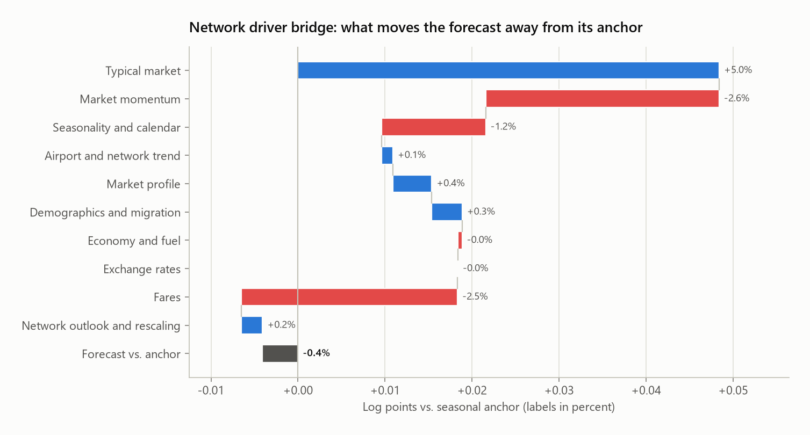
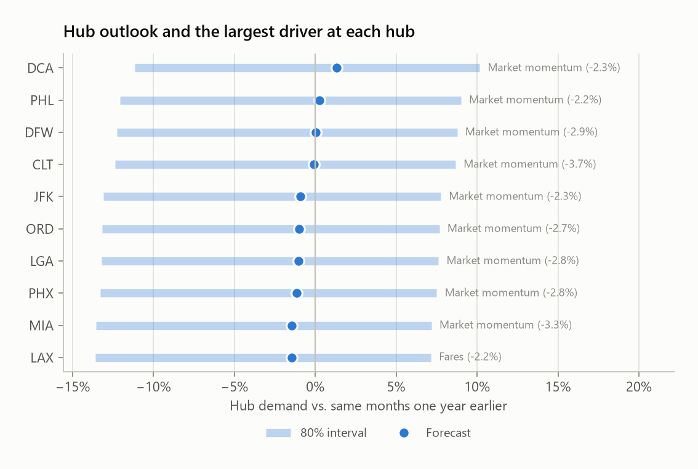

> This package is now part of the official Team 3 repository, [AsvM45/ADSC_AA_Team3](https://github.com/AsvM45/ADSC_AA_Team3). I am listed there as the [#1 contributor](https://github.com/AsvM45/ADSC_AA_Team3/blob/main/CONTRIBUTORS.md) for the `aaforecast` forecasting package and the macro price analysis script.
>
> - Team Members: Asvath Madhan, Vignesh Nagarajan, Pranav Sundar, Johnathan Shirley, Calvin Heiman, Sashwath Nandhakumar
> - Final Deliverable: [presentation](https://claude.ai/artifact/LxCE5cJuDd19geJV6i9nm6)

# American Airlines F26: O&D Demand Forecasting

Aggie Data Science Club, Team 3, working with the American Airlines Operations Research and Advanced Analytics (ORAA) team in Fort Worth, Texas.

This repo forecasts monthly origin and destination (O&D) passengers, or revenue, **12 to 18 months ahead**. That is the window where networks and schedules get built. Every forecast comes with an interval, the drivers behind it, and a hub-level rollup.

## The Approach: Anchor And Adjust

Each market forecast is built in three layers, each one something a planner can check:

1. **Seasonal anchor.** The market's trailing 12-month level times its own seasonal shape for the target month. This is the "nothing changes" view.
2. **Network outlook.** One growth number for the whole network. It defaults to flat, and you can set your own planning assumption with `--network-growth`.
3. **Market mix.** A gradient-boosted model trained across all markets learns which ones will outgrow or lag the network. Markets are then rescaled to add up to the network outlook.

The mix model uses momentum, catchment population, migration ties, fares, fuel, the US economy, and exchange rates.

The model learns relative movement, not the network level. That keeps the post-pandemic rebound, which lifted every market at once, from leaking into a 2027 forecast. The weight on the learned mix is picked by backtest. More detail is in [docs/methodology.md](docs/methodology.md).

## Results

Backtested over five rolling origins, 12 to 18 months ahead. Full write-up, with more charts, in [docs/results.md](docs/results.md).

- **17.9% market WAPE**, against 19.0% for "same month last year" and 24.3% for "last year times trend." The gain holds across market sizes, segments, and horizons, and is significant (Wilcoxon p < 1e-100).
- **8.5% at the origin airport and 5.6% at the network** once markets are rolled up.
- **80% intervals cover 73% to 83%** of held-out outcomes, depending on the fold.



| | |
| --- | --- |
|  |  |
|  |  |

The production forecast for July 2027 to January 2028 sits 1.5% below the same months a year earlier with the network held flat. Market momentum and fares pull it down the most.

| | |
| --- | --- |
|  |  |

Charts show relative values only and are rebuilt with `python scripts/make_figures.py`.

## What It Produces

| Output | Use |
| --- | --- |
| Market forecast | Monthly O&D forecast with an 80% interval, for every market |
| Hub summary | Demand touching each AA hub, and the driver that moves it most |
| Driver bridge | How momentum, demographics, the economy, FX, and fares move each forecast away from its anchor |
| Watchlist | Markets set to outgrow or lag the network, and markets with unusually wide intervals |
| Scenarios | How demand shifts between segments and hubs under a fuel spike, a recession, or a dollar swing |
| Backtest | Accuracy at market, airport, hub, and network level against planner baselines |

Results are written to `outputs/`, which stays on your machine.

## Data

The AA datasets are confidential under NDA and are **never committed**. Put them in `data/raw/`, which is gitignored:

```
data/raw/AA_PAX_FORECASTING.csv
data/raw/AA_AIRPORT_INFO.csv
```

Public sources are downloaded by `python -m aaforecast fetch`:

| Source | How it is used |
| --- | --- |
| [Census metro area population](https://www.census.gov/data/tables/time-series/demo/popest/2020s-total-metro-and-micro-statistical-areas.html) | Growth of each airport's home metro |
| [Census county population](https://www.census.gov/programs-surveys/popest.html) | Catchment population for each airport |
| [County boundaries](https://public.opendatasoft.com/explore/dataset/us-county-boundaries/) | Assign every county to its nearest network airport |
| [FAA enplanements](https://www.faa.gov/airports/planning_capacity/passenger_allcargo_stats/passenger) | Airport-level traffic trends |
| [County-to-county migration](https://www.census.gov/topics/population/migration/guidance/county-to-county-migration-flows.html) | Movers between two catchments, a proxy for visiting friends and relatives demand |
| [FRED](https://fred.stlouisfed.org/) | Jet fuel, Brent, unemployment, consumer sentiment, CPI, income, and exchange rates |

Every external value respects its publication lag, so the backtest only sees what a planner would have had at the time.

## Quick Start

```bash
pip install -e ".[dev]"
python -m aaforecast all          # validate, fetch, eda, backtest, forecast
python -m aaforecast backtest --fast   # largest 1,500 markets, a few minutes
python -m aaforecast forecast --network-growth 0.03   # plan with +3% network growth
python -m aaforecast forecast --target rev   # forecast revenue instead of passengers
pytest
```

## How It Is Validated

- **Rolling origins.** Five forecast origins from 2024-01 to 2025-01, each trained only on data available at that date and scored on months 12 to 18 ahead.
- **Baselines.** Same month last year, last year times trend, and the seasonal anchor alone.
- **Significance.** Wilcoxon signed-rank test and a bootstrap interval on the WAPE gap, both over markets.
- **Interval coverage.** Each fold's intervals come only from the other folds' errors.
- **Leakage tests.** Unit tests change future data and confirm that no feature moves.

## Repository Layout

```
src/aaforecast/
  data.py, validate.py      load, clean, and check the AA files
  geo.py, calendar.py       distances, catchments, holidays
  external/                 Census, FAA, FRED, and county data
  features.py               feature rows per market, origin, and horizon
  model.py                  Anchor and Adjust
  backtest.py, metrics.py   rolling-origin evaluation and tests
  explain.py, scenario.py   driver bridge and what-if scenarios
  forecast.py, report.py    planning outputs and summaries
  eda.py, stats_tests.py    exploratory analysis and diagnostics
tests/                      synthetic-data unit tests
scripts/make_figures.py     rebuild docs/figures from outputs/
docs/methodology.md         full method write-up
docs/results.md             results with charts
```

## Team Resources

Team 3 files, training modules, meeting notes, and resources are on the [team Google Drive](https://drive.google.com/drive/folders/1Jlm6jUfIagWXPhwDPKvIEHW5PiGNsP61).
