# Results

Passenger results from the full backtest and the production forecast. Every chart is built by `python scripts/make_figures.py` from the local `outputs/` folder.

All figures here are relative: error rates, coverage, and percent changes. Absolute passenger and revenue counts stay in `outputs/`, which is gitignored under the NDA.

## Headline

- **Market error of 17.9% WAPE** at 12 to 18 months out, against 19.0% for "same month last year" and 24.3% for "last year times trend."
- **The gain is real.** Anchor and Adjust beats every baseline across markets, with a bootstrap interval that excludes zero and a Wilcoxon p-value below 1e-100.
- **Rolled-up totals land close.** 8.5% WAPE at the origin airport and 5.6% at the network.
- **Intervals are honest on held-out folds.** Market coverage runs 73% to 83% against an 80% target.
- **Outlook for July 2027 to January 2028 is -1.5%** versus the same months a year earlier, with the network held flat. Momentum and fares pull it down.

## How A Forecast Is Built

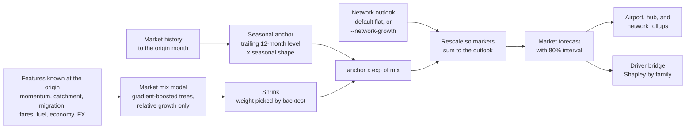

## How It Is Tested

Five rolling origins. Each fold trains only on data available at its origin and is scored on months 12 to 18 ahead.

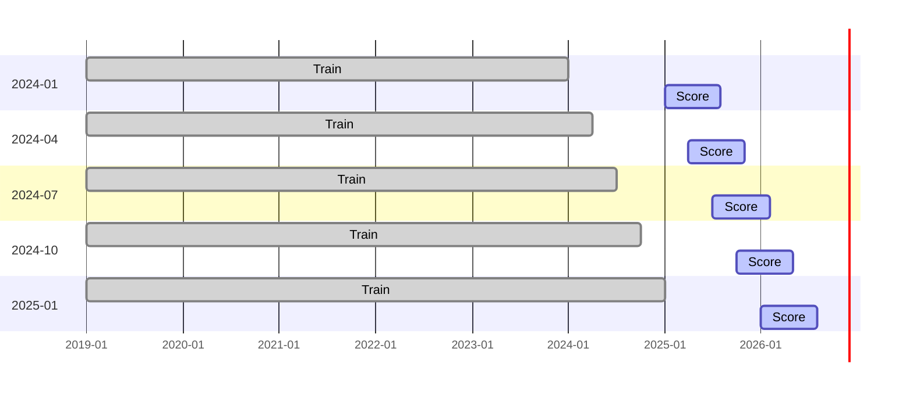

Pandemic target months (2020-03 to 2021-12) are dropped from training, and every external series respects its publication lag.

## Accuracy

### By Planning Level

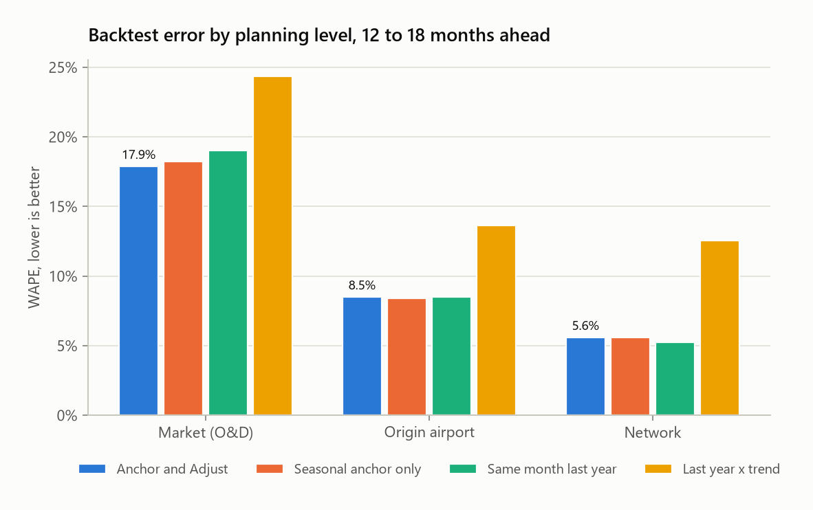

| Level | Anchor and Adjust | Seasonal anchor only | Same month last year | Last year x trend |
| --- | --- | --- | --- | --- |
| Market (O&D) | **17.9%** | 18.2% | 19.0% | 24.3% |
| Origin airport | 8.5% | **8.4%** | 8.5% | 13.7% |
| Network | 5.6% | 5.6% | **5.3%** | 12.6% |

The learned mix earns its keep at the market level, where planners need it most. Once markets are summed, their relative errors mostly cancel, so the totals depend on the seasonal anchor and the network outlook. That is why the three anchored methods sit close together at the airport and network level. Bias is +2.4% for Anchor and Adjust at every level, because rescaling ties market totals to the network.

### By Horizon

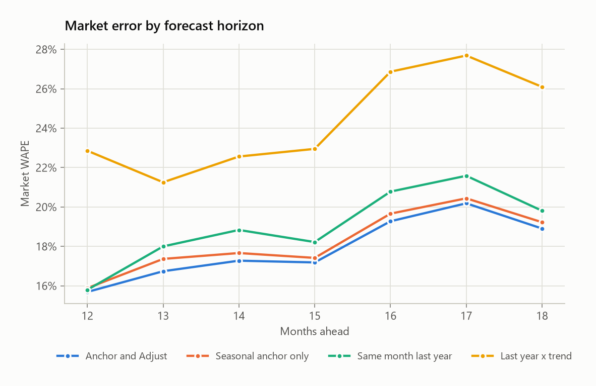

Error rises from 15.7% at 12 months to a peak of 20.2% at 17 months, then eases to 18.9% at 18. Anchor and Adjust stays below each baseline at every horizon. At 12 months, "same month last year" is nearly as good, since the anchor and last year's month are only a year apart; the gap opens from 13 months on.

### By Market Size And Segment

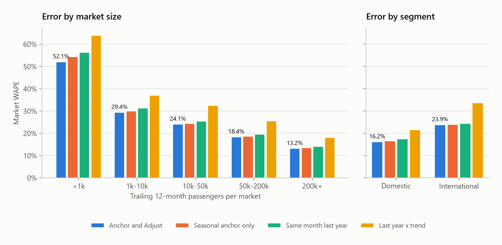

Small markets are noisy: markets under 1,000 passengers a year miss by half. Markets over 200,000 miss by 13.2%. International markets run about 8 points harder than domestic ones. The ranking of methods holds in every band and both segments.

### Is The Gain Real

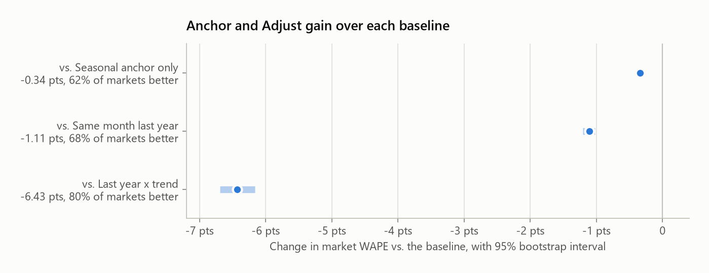

| Compared with | WAPE gap | 95% bootstrap interval | Markets improved | Wilcoxon p |
| --- | --- | --- | --- | --- |
| Seasonal anchor only | -0.34 pts | -0.40 to -0.28 | 61.6% | 3.2e-101 |
| Same month last year | -1.11 pts | -1.20 to -1.02 | 68.0% | < 1e-300 |
| Last year x trend | -6.43 pts | -6.69 to -6.17 | 79.9% | < 1e-300 |

The gain over the seasonal anchor alone is small but consistent. Most of the gain over "same month last year" comes from the anchor itself: averaging two clean years of seasonal shape beats a single prior-year month.

### Picking The Weight On The Learned Mix

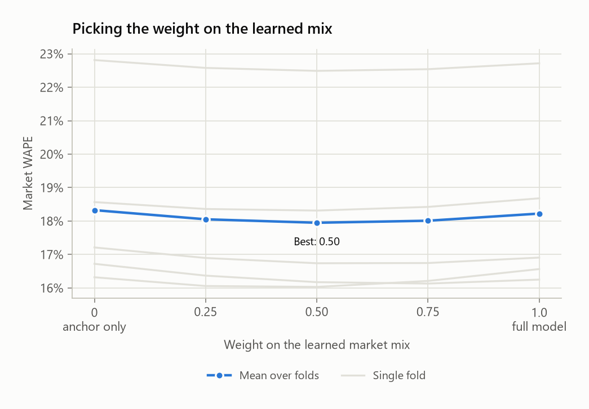

Full trust in the learned mix (weight 1.0) does worse than half trust. The curve has the same shape in every fold, with the minimum at 0.5 in four folds and 0.75 in one. Each fold uses only earlier folds to pick its weight, and the production forecast uses 0.5.

### Error At AA Hubs

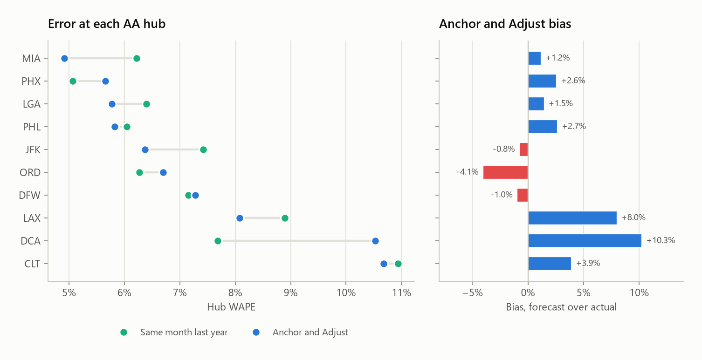

Anchor and Adjust beats "same month last year" at 6 of the 10 hubs. DCA is the clear miss: a +10.3% bias, with WAPE 2.8 points worse than the baseline. LAX also over-forecasts, by 8.0%. Both hubs are worth a planner's second look before trusting the outlook there.

## Interval Coverage

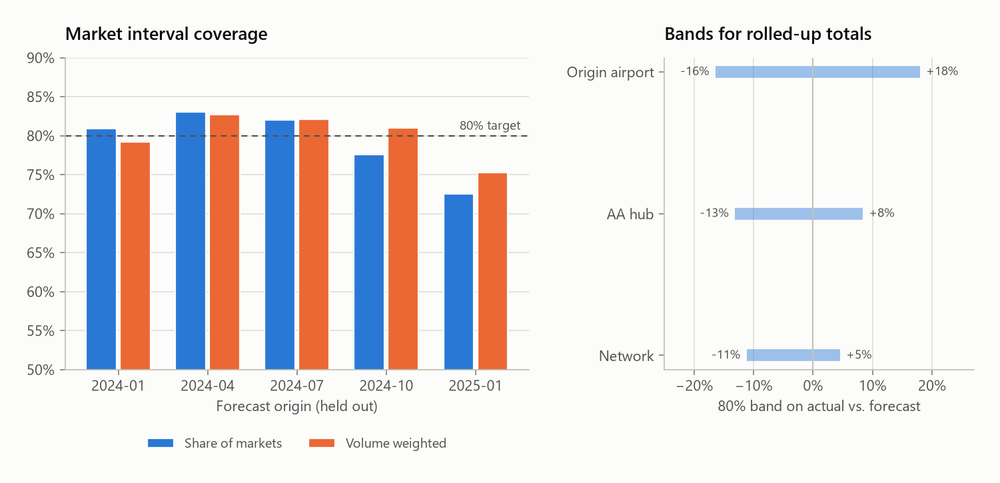

Market intervals are scored on held-out folds only. The first four folds land between 78% and 83%. The 2025-01 fold, whose scoring window is the most recent, under-covers at 72.5% (75.3% volume weighted). That suggests 2026 moved more than earlier years did, and that intervals may run narrow in a fast-changing year.

Bands on rolled-up totals come from errors measured at those totals, not from adding market bounds. Network bands are asymmetric (-11% to +5%) because the backtest years tended to come in below forecast at the network level.

## Production Forecast

Target months July 2027 to January 2028, with the network outlook held flat.

### Network

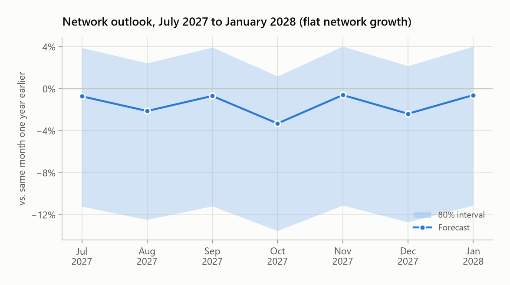

The network forecast sits 0.6% to 3.3% below the same month a year earlier. With flat network growth, that gap is the seasonal anchor itself: the trailing 12-month level is a little below the most recent same months. Set `--network-growth` to plug in a corporate view.

### What Moves The Forecast

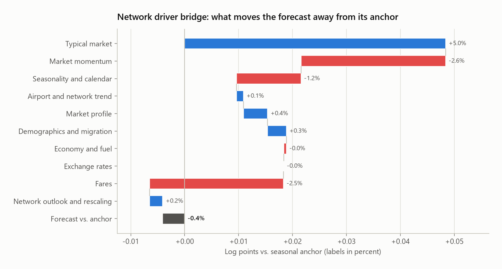

The driver bridge splits each market's move away from its anchor into exact Shapley values over eight driver families, then weights by volume. A typical market starts 5.0% above its anchor. Market momentum (-2.6%) and fares (-2.5%) pull most of that back. Demographics, market profile, and airport trend add a little. The economy, fuel, and exchange rates barely move the network today.

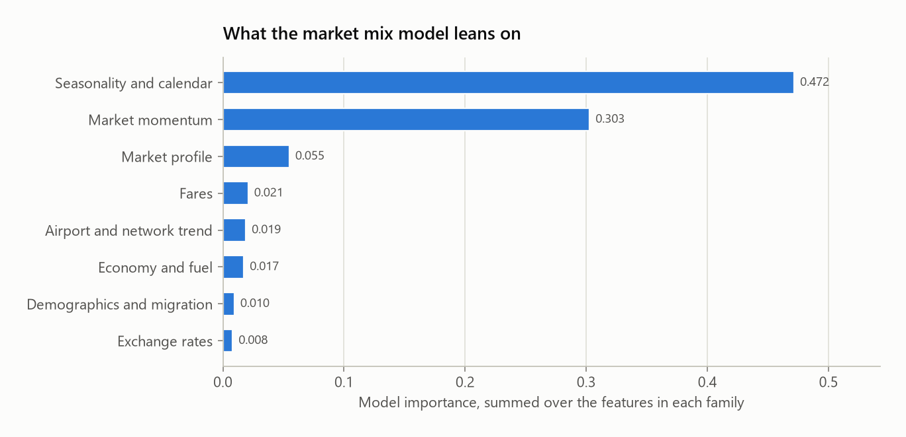

The model leans on seasonal shape and recovery momentum. Macro and FX features carry little weight, which matches the known limit: seven years of history, two of them disrupted, leave little room to learn macro response.

### Hubs

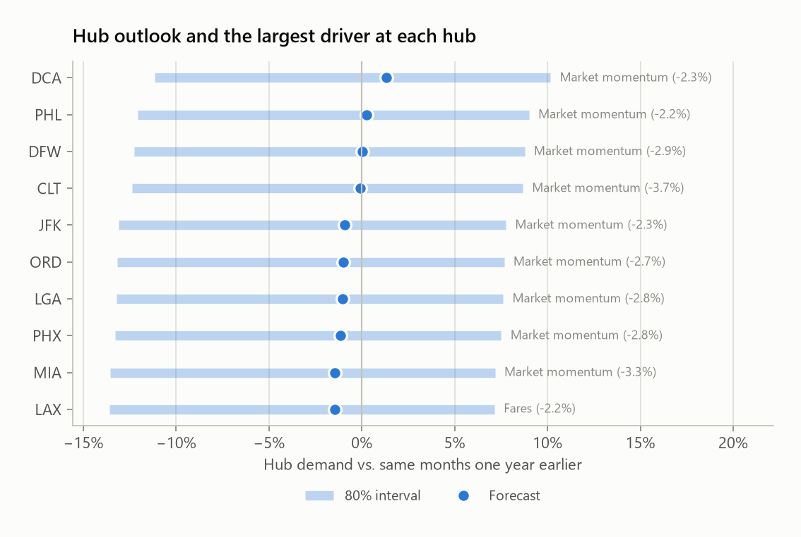

DCA (+1.3%) and PHL (+0.2%) are the only hubs forecast to grow, with DFW flat. LAX (-1.5%) and MIA (-1.4%) soften the most. Momentum is the largest driver at nine of ten hubs; at LAX it is fares.

### Watchlist

| Flag | Markets |
| --- | --- |
| In line | 8,952 |
| High uncertainty | 983 |
| Lagging network | 322 |
| Outgrowing network | 309 |

HNL to LIH and LAX to GDL, both directions, sit 8% to 9% below their anchors and are flagged as lagging the network.

### Scenarios

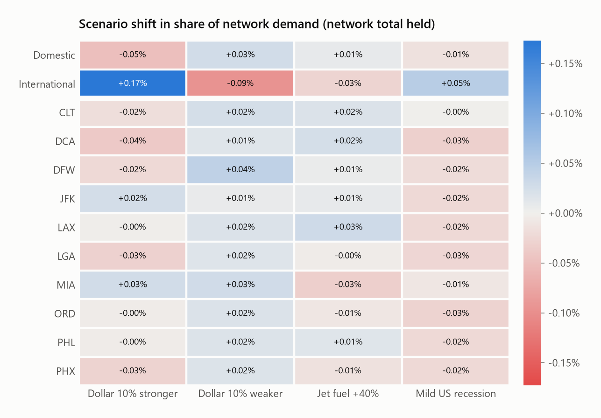

Each scenario shifts the economy, fuel, or FX features at the origin and re-scores every market, holding the network total at the outlook. A 10% stronger dollar moves the most share: +0.17% toward international. Every hub shift stays under 0.05% of network demand. These are sensitivities learned from 2019 onward, not causal effects, and their small size matches the low weight the model puts on macro features.

## Exploratory Findings

- The trailing 12 months are at 98.3% of 2019 passenger volume across the network.
- A Chow test finds a structural break at 2020-03 (F = 2.8, p = 0.003), which is why pandemic target months are dropped.
- Seasonal strength is 0.81 on a 0 to 1 scale for the network since 2022, and the median top-200 market is 0.80. Seasonality dominates, so each market keeps its own seasonal anchor.
- Network passengers since 2022 test as stationary (ADF p = 0.023, KPSS p = 0.091).

## What Would Help Most

- **Capacity and schedule plans.** Planned seats per market would explain much of the market-level error that momentum and fares cannot.
- **A wider interval in fast-moving years.** The 2025-01 fold under-covers, so the bands could widen when recent errors run large.
- **A check on DCA and LAX bias.** Both hubs over-forecast in the backtest by 8% or more.
